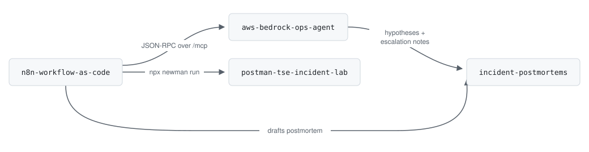

&ensp;&ensp;&ensp;

I'm a Technical Support Engineer with 6 years of experience troubleshooting APIs, authentication, and integrations, including Tier 2 and Tier 3 escalations. I also help customers get started through onboarding, product demos, and working proofs of concept.

I turn unclear reports into problems engineering can reproduce, and build automations that cut down the manual work around them. The projects below cover API integrations, AI-assisted triage, and repeatable troubleshooting, with runnable examples, automated checks, and the limits spelled out.

---

### ✦ FEATURED WORK

#### 📂 [edi-failure-triage](https://github.com/h-vance/edi-failure-triage) &nbsp;·&nbsp; [sandbox demo ↗](https://edi-failure-triage.onrender.com/)
A support copilot that takes a failed transaction from an Intercom sandbox ticket through n8n to a triage result and an internal note for the support engineer. The transactions and payloads are mock data based on public documentation; the repo includes a walkthrough, runnable fixtures, and a clear account of what's real and what's simulated.

#### 📂 [n8n-workflow-as-code](https://github.com/h-vance/n8n-workflow-as-code)
n8n workflows written in TypeScript and compiled to importable JSON, connecting triage tools, API checks, container operations, and SQL reporting. CI checks that the compiled workflows match their source; running them against a live n8n instance is a separate local step, with real and simulated behavior documented per workflow.

#### 📂 [aws-bedrock-ops-agent](https://github.com/h-vance/aws-bedrock-ops-agent) &nbsp;·&nbsp; [demo ↗](https://aws-bedrock-ops-agent.onrender.com/)
An L2 triage copilot that turns incident evidence into ranked hypotheses, recommended checks, and escalation notes. The same logic is available through REST and MCP, with an offline mock mode, a live Bedrock mode, and documentation covering setup, tracing, and known limits.

#### 📂 [prove-it-labs](https://github.com/h-vance/prove-it-labs) &nbsp;·&nbsp; [take an exercise ↗](https://h-vance.github.io/prove-it-labs/)
Twenty-six hands-on support exercises across nine tracks, each starting with a customer describing a symptom and no hint about what broke. The grader shows the command, assertion, and raw output; CI checks the broken and fixed states against real Docker and `kind` clusters, with the full review in [`AUDIT.md`](https://github.com/h-vance/prove-it-labs/blob/main/AUDIT.md).

#### 📂 [postman-tse-incident-lab](https://github.com/h-vance/postman-tse-incident-lab)
Four API incidents: a revoked key, insufficient scope, a wrong route, and rate limiting. Each runs against a local API, includes the customer response or engineering handoff, and has its diagnosis checked by assertions in CI.

#### 📂 [cloud-operations-runbook](https://github.com/h-vance/cloud-operations-runbook)
Fifteen runbooks for compute, networking, identity, and application troubleshooting, written to the same template so the next one is predictable to follow at 3am. The point is simple: turn what one person knows into something the next person on the rota can use.

#### 📂 [self-healing-microservices-cluster](https://github.com/h-vance/self-healing-microservices-cluster)
A Kubernetes workload tested against forced liveness failures, container OOMs, and pod deletions on a real `kind` cluster. CI checks recovery, while a Prometheus alert routes through Alertmanager to a remediation controller that records deployment state before and after.

#### 📂 [aws-landing-zone-terraform](https://github.com/h-vance/aws-landing-zone-terraform)
A multi-account AWS organization defined in Terraform, with organizational units, service control policies, and CloudTrail logging into an isolated archive account. Validated and linted in CI, but never applied to a live organization; the README explains that limit and the evidence still needed.

---

### ✦ HOW THEY FIT TOGETHER

The n8n workflows connect the Bedrock triage agent, Postman incident lab, and postmortem drafts. This diagram shows that incident workflow.

<picture>
  <source media="(prefers-color-scheme: dark)" srcset="how-they-fit-dark.svg">
  
</picture>

---

### ✦ TECH STACK

<table>
  <tr><td align="right" width="130">Support&nbsp;Ops</td><td>     </td></tr>
  <tr><td align="right" width="130">AI&nbsp;&amp;&nbsp;Agents</td><td>    </td></tr>
  <tr><td align="right" width="130">Infra</td><td>    </td></tr>
  <tr><td align="right" width="130">Tools</td><td>       </td></tr>
</table>

---

### ✦ SUPPORT TOOLING & DIAGNOSTICS

| Repo | Stack | Problem | Resolution |
|:-----|:------|:--------|:-----------|
| [Incident-Postmortems](https://github.com/h-vance/incident-postmortems) | Docs | Incidents repeating with no record | Blameless RCAs in standard formats |
| [Ops-Diagnostics](https://github.com/h-vance/ops-diagnostics) | Python, Bash | Manual verification slowing MTTR | API health checks, SSL certificate validation, log analysis, system snapshots |
| [Log-Rotation-Maintenance](https://github.com/h-vance/log-rotation-maintenance) | Bash | Logs filling server storage | Auto-rotation, compression, cleanup |
| [Docker-TSE-Incident-Lab](https://github.com/h-vance/docker-tse-incident-lab) | Docker | Container failures diagnosed by guesswork | Three reproducible scenarios, outcomes asserted in CI |
| [AWS-Automated-Remediation-Pipeline](https://github.com/h-vance/aws-automated-remediation-pipeline) | Terraform, Python | Manual response to a known, repeatable failure | CloudWatch to EventBridge to Step Functions to a Lambda that quarantines an instance. Validated in CI, never applied |
| [Cloud-Service-Baseline](https://github.com/h-vance/cloud-service-baseline) | FastAPI, Docker, Terraform | Monitoring with nothing real to fire against | A service built to be broken on purpose, with endpoints to force failure |

---

US citizen. Remote-first; open to technical support, solutions, and implementation roles with US and APAC teams.

**Contact:** [hvance788@gmail.com](mailto:hvance788@gmail.com) | [LinkedIn](https://linkedin.com/in/harrison-vance) | [harrisonvance.cc](https://harrisonvance.cc)
